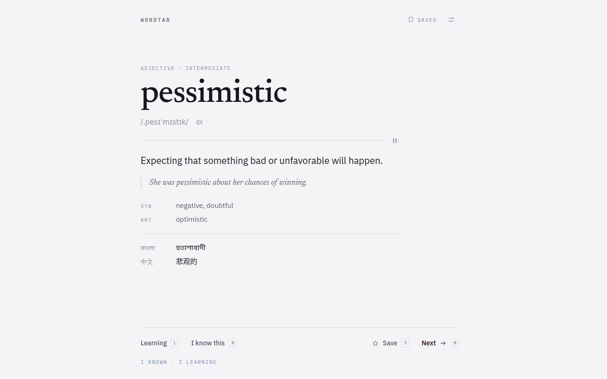
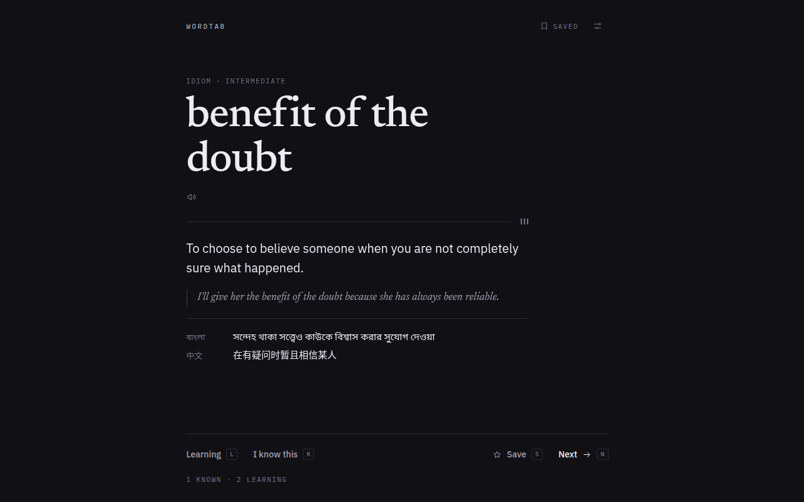
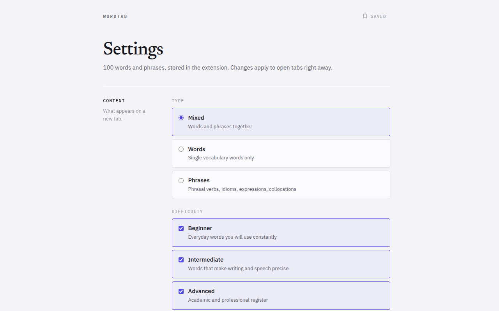
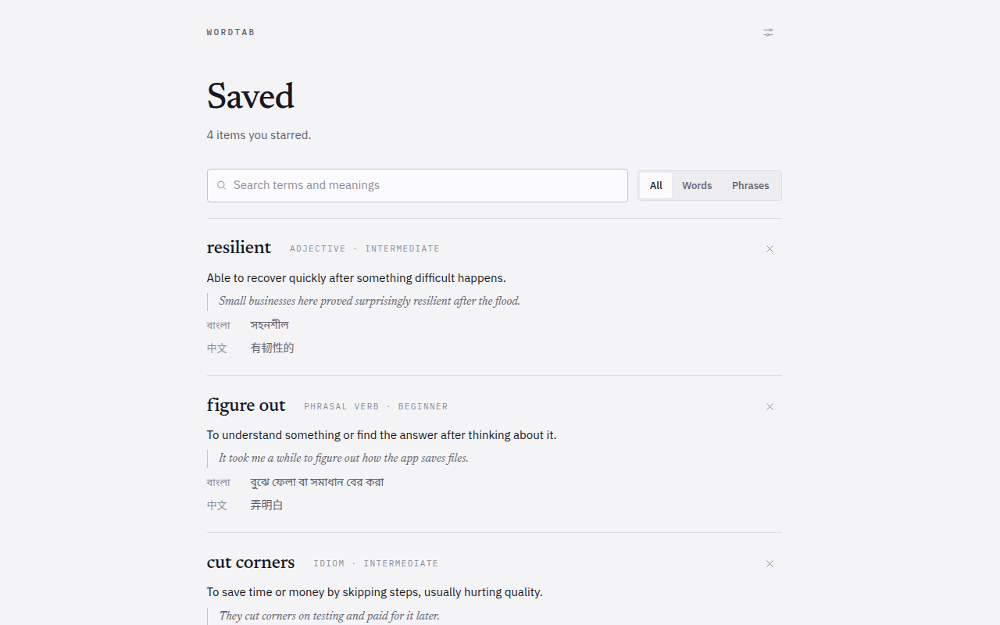

# PhraseTab

**Learn a word or phrase with every new tab.**

PhraseTab is a Chrome extension that replaces the New Tab page with a single
English vocabulary entry — a word, a phrasal verb, an idiom, an expression or a
collocation — set as a dictionary entry rather than a dashboard widget.

It deliberately does *not* show you something new on every tab. You might open
forty tabs a day; you cannot learn forty words a day. The same entry stays for a
few views (three by default) before it rotates, and `Next` moves on whenever you
want. Repetition is the product.

Everything runs locally. No account, no backend, no analytics, no network
requests — the extension asks for exactly one Chrome permission, `storage`, and
works fully offline the moment it is installed.

---

## Screenshots

| New Tab — light | New Tab — dark |
|---|---|
|  |  |

| Settings | Saved |
|---|---|
|  |  |

---

## Technology

- **Chrome Extension Manifest V3**, New Tab override
- **TypeScript** (strict, with `noUncheckedIndexedAccess` and
  `exactOptionalPropertyTypes`)
- **React 18** + **Vite 6** — three static HTML entry points, no router
- **Plain CSS** with custom-property theme tokens; no CSS framework
- **Vitest** for unit tests
- **No backend, no database, no runtime AI, no third-party requests**

The New Tab entry chunk is ~12 KB and the whole packaged extension is ~420 KB,
most of which is the two bundled typefaces.

---

## Prerequisites

- **Node.js 20.19+** (or 22.12+) and npm 10+
- **Google Chrome 108+**

---

## Getting started

```bash
npm install
npm run build
```

`dist/` is now a complete unpacked extension.

### Install it in Chrome

1. Open `chrome://extensions` in Chrome.
2. Turn on **Developer mode** (toggle, top right).
3. Click **Load unpacked**.
4. Select the **`dist`** folder inside this repository — not the repository
   root, and not `public/`.
5. Open a new tab. PhraseTab takes over the New Tab page and runs onboarding once.

Chrome may show a "An extension has changed your New Tab page" prompt the first
time. Choose **Keep it** to let PhraseTab through.

After changing code, run `npm run build` again and press the **reload** icon on
the PhraseTab card in `chrome://extensions`.

> Loading an unpacked extension from the command line (`--load-extension`) is
> blocked in Google Chrome 137 and later. Use the `chrome://extensions` flow
> above, or a Chromium build, for automation.

---

## Development

```bash
npm run dev        # Vite dev server — open the printed URL + /newtab.html
npm run build      # typecheck, then build dist/
npm run build:debug# same, with sourcemaps (roughly doubles the bundle)
npm run preview    # serve the production build
```

In `npm run dev` the pages run outside the extension, so `chrome.storage` does
not exist. The storage layer falls back to `localStorage`, which means settings
and progress still persist across reloads — clear your site data (or run
`localStorage.clear()`) to replay onboarding.

Useful dev URLs: `/newtab.html`, `/settings.html`, `/saved.html`.

---

## Testing

```bash
npm test           # unit tests (Vitest)
npm run test:watch # watch mode
npm run typecheck  # tsc --noEmit
npm run lint       # ESLint
npm run verify     # check dist/ is a valid, offline, minimal-permission MV3 build
npm run check      # lint + typecheck + test + build + verify
```

`npm run verify` is the one worth knowing about. It reads `dist/` and fails the
build if PhraseTab's core promises are broken: an extra Chrome permission, a
`host_permissions` entry, an inline `<script>` that Manifest V3's CSP would
block, or any reference that would hit the network. Those are all easy to
introduce by accident and invisible in a screenshot.

### What the tests cover

**Selector and repetition logic** (`src/learning/selector.test.ts`) — eligible
item selection, content-type and difficulty filters, holding an item for its
exposure budget, `Next` forcing rotation, avoiding an immediate repeat, learning
items being favoured, known items being deprioritised without being excluded,
and the single-eligible-item case terminating instead of looping.

**Storage** (`src/storage/storage.test.ts`) — defaults on empty storage,
round-tripping, settings surviving a progress write and vice versa, and
migration: any corrupt or unknown field is repaired to a default rather than
throwing, so a bad write can never brick the New Tab page.

**Dataset** (`src/data/dataset.test.ts`) — every entry satisfies the schema, IDs
and normalised terms are unique, every item carries both translations, and each
difficulty level has at least one word *and* one phrase, so no combination of
filters can empty the library.

**Validator** (`src/data/schema.test.ts`) — the validator itself, against
deliberately malformed input.

**New Tab, end to end** (`src/newtab/NewTab.test.tsx`) — onboarding gating the
card and recording no exposure while it is up, each action reaching the selector
and persisting, `Save` *not* rotating the card away, the keyboard shortcuts, and
modifier combinations like Ctrl+N being left alone for the browser.

**Saved page** (`src/saved/Saved.test.tsx`) — ordering, search over terms and
definitions, the type filter, both empty states, and unsaving an item without
erasing what was learned about it.

106 tests across 6 files.

### Manual checks before release

- [ ] Loads unpacked with no errors on the `chrome://extensions` card
- [ ] New Tab override works; opening a tab shows an entry
- [ ] The same entry returns for the configured number of views, then rotates
- [ ] `Next` rotates immediately
- [ ] Learning / I know this / Save persist after a browser restart
- [ ] Keyboard: `L`, `K`, `S`, `N` / `→`, `P` all work
- [ ] Light, dark and system themes; no flash of the wrong theme on a new tab
- [ ] `Listen` speaks the term (and the button is absent where speech is not available)
- [ ] Bangla and Chinese toggles show and hide translations
- [ ] Turning off two difficulty levels still shows entries from the third
- [ ] Saved page: search, type filter, remove, and the empty state
- [ ] No console errors on any of the three pages
- [ ] Works with the network disconnected

---

## Project structure

```text
wordtab/
├── CLAUDE.md                  Project instructions
├── PLAN.md                    Product and engineering plan, milestone status
├── README.md
├── THIRD_PARTY_NOTICES.md     Font licences; dataset provenance
├── newtab.html                Entry points. Vite builds these into dist/
├── settings.html
├── saved.html
├── public/                    Copied verbatim into dist/
│   ├── manifest.json          Manifest V3
│   ├── theme-init.js          Pre-paint theme script (external: MV3 CSP blocks inline)
│   ├── fonts.css              Generated @font-face rules
│   ├── fonts/                 Bundled woff2 (latin subset)
│   └── icons/                 Generated PNG icons
├── docs/                      README screenshots
├── scripts/
│   ├── fetch-fonts.mjs        Downloads and self-hosts the typefaces
│   ├── generate-icons.py      Renders the extension icons
│   └── verify-build.mjs       Asserts dist/ stays offline and minimal
└── src/
    ├── newtab/                New Tab page, state hook, its stylesheet
    ├── settings/              Settings page
    ├── saved/                 Saved items page
    ├── onboarding/            First-run flow
    ├── components/            VocabularyCard, ActionBar, TranslationBlock, …
    ├── data/                  vocabulary.json, validator, dataset tests
    ├── learning/              Selection and repetition engine
    ├── storage/               chrome.storage wrapper, persisted shapes
    ├── speech/                Speech synthesis
    ├── theme/                 Theme resolution
    ├── styles/                Design tokens and shared primitives
    └── types/                 Vocabulary types
```

---

## Data, sources and licensing

The bundled dataset is **100 entries** — 50 single words and 50 phrases
(20 phrasal verbs, 15 idioms, 5 expressions, 10 collocations) — spread across
Beginner, Intermediate and Advanced.

Every definition, example sentence and translation is original work written for
PhraseTab. Nothing is copied from any dictionary, and no third-party lexical
dataset is bundled. See `THIRD_PARTY_NOTICES.md`.

Difficulty uses PhraseTab's own three levels rather than claiming CEFR alignment,
since no appropriately licensed CEFR mapping is bundled.

### How to add a vocabulary item

Add an object to `items` in `src/data/vocabulary.json`:

```json
{
  "id": "word-succinct",
  "term": "succinct",
  "normalizedTerm": "succinct",
  "kind": "word",
  "partOfSpeech": "adjective",
  "difficulty": "advanced",
  "definition": "Expressed clearly in very few words.",
  "example": "Her summary was succinct and easy to act on.",
  "synonyms": ["concise", "brief"],
  "antonyms": ["rambling"],
  "pronunciation": { "ipa": "/səkˈsɪŋkt/" },
  "translations": { "bn": "সংক্ষিপ্ত ও স্পষ্ট", "zh-CN": "简洁的" },
  "tags": ["writing"],
  "source": "wordtab-original"
}
```

Rules the validator enforces (`npm test` will tell you if you break one):

- `id` is unique and kebab-case, prefixed by kind (`word-`, `phrasal-`,
  `idiom-`, `expression-`, `collocation-`)
- `normalizedTerm` equals the term lowercased with whitespace collapsed
- `kind` is one of `word`, `phrasal_verb`, `idiom`, `expression`, `collocation`
- `difficulty` is `beginner`, `intermediate` or `advanced`
- `definition` and `example` are non-empty, original, and the example actually
  uses the term
- optional arrays contain only non-empty strings
- translations are non-empty strings under a known language code

To record a second sense of an existing term, add `"duplicate-sense"` to its
`tags`; the uniqueness check will let it through.

Write definitions in plain English a learner can read without a second lookup,
and make the example a sentence someone would really say.

### How to add a translation language

The schema is built for this — four small edits, no code restructuring:

1. **`src/types/vocabulary.ts`** — add the code to
   `TRANSLATION_LANGUAGE_CODES`, and an entry to `TRANSLATION_LANGUAGES` with
   its native label, English label and BCP-47 tag:

   ```ts
   export const TRANSLATION_LANGUAGE_CODES = ['bn', 'zh-CN', 'es'] as const;

   { code: 'es', nativeLabel: 'Español', englishLabel: 'Spanish', bcp47: 'es' },
   ```

2. **`src/data/vocabulary.json`** — add the translation to each item's
   `translations` object.

3. **Run `npm test`.** The dataset test requires every supported language on
   every item, so it will list exactly what is missing.

4. Nothing else. Settings, onboarding, the card and the Saved page all render
   from `TRANSLATION_LANGUAGES`, and existing users' settings migrate safely
   because unknown codes are dropped on read.

Consider whether the script needs a bundled font. Latin-script languages use the
fonts already shipped; other scripts fall back to the system, which is the
current behaviour for Bangla and Chinese.

---

## Privacy

PhraseTab collects nothing.

- **One permission:** `storage`. Nothing else.
- **No host permissions and no content scripts.** PhraseTab cannot read any page
  you visit, and never runs outside its own tabs.
- **No network requests.** Vocabulary, fonts and icons are all bundled. The
  extension works with the network disconnected, and nothing is sent anywhere.
- **No account, no telemetry, no analytics, no ads, no cloud sync.**
- **No browsing history access.**

Your settings and learning progress live in `chrome.storage.local` on your own
machine. Removing the extension removes them.

`npm run verify` enforces the permission and no-network claims mechanically, so
they cannot regress unnoticed.

---

## Accessibility

- Semantic HTML with real `<fieldset>`/`<legend>`, `<dl>`, `<blockquote>`
- Every control is keyboard-operable, with visible `:focus-visible` outlines
- Keyboard shortcuts on the New Tab page: `L` learning, `K` known, `S` save,
  `N` or `→` next, `P` pronounce
- Icon-only buttons carry `aria-label`; toggles carry `aria-pressed`
- `prefers-reduced-motion` disables the entrance animation
- Translations are marked with `lang` so screen readers switch voice correctly
- Layout uses relative units and reflows down to narrow widths and high zoom

---

## Design

The New Tab page is a dictionary entry set at poster scale. There is no card —
no box, shadow or border around the word — because a card reads as a dashboard
widget, and this should read as a page you happened to open. The column is
centred but the type inside is left-aligned, so a one-word headword and a
five-word phrase never shunt the layout sideways.

One structural device carries the page: a hairline under the headword, with the
repetition tally at its end. That tally is the only visible trace of the
learning model, and it is the reason the same word keeps coming back.

Three typefaces, each with one job: **Newsreader** for the headword and example,
**IBM Plex Sans** for prose and controls, **IBM Plex Mono** for metadata.

---

## Status

MVP milestones 0–9 are implemented. See `PLAN.md` for the milestone checklist
and for the features deliberately deferred past V1.
